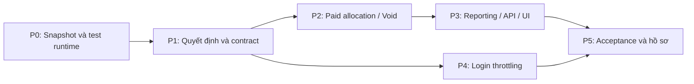

# Kế hoạch khắc phục sau rà soát — tổng thể

> **For agentic workers:** Use `superpowers:executing-plans` to execute task-by-task with checkpoints. Chỉ dùng `superpowers:subagent-driven-development` khi người dùng chọn giao việc cho subagent. Mọi checkbox dưới đây là công việc tương lai, không phải kết quả đã đạt.

**Goal:** Khắc phục F1–F8, thống nhất nguồn yêu cầu và tái nghiệm thu cây mã hiện tại mà không làm mất công việc hoặc lịch sử tài chính.

**Architecture:** Giữ modular monolith, Vue SPA, SQL Server và các domain hiện có. Sửa tại nơi sở hữu paid snapshot/reversal, rồi nối reporting và giao diện vào cùng dữ liệu đúng. Quyết định mới phải được ghi nhận trước khi thay đổi nghiệp vụ phụ thuộc.

**Tech Stack:** Java 25, Spring Boot 4.1.1, Spring Security, Maven Wrapper, SQL Server/Flyway; Vue 3, TypeScript, Vite, Vitest, pnpm.

**Spec:** Đầu vào là [báo cáo audit](../../SESSION_AUDIT_2026_09_13.md), AGENTS và các ADR/rules hiện hành. Audit không phải approved feature spec; phần quyết định bên dưới có trạng thái **PROPOSED / OPEN DECISION** cho tới khi được xác nhận.

## Global Constraints

**Execution update, 2026-09-13:** Người dùng đã duyệt thực hiện các phương án
khuyến nghị D1–D6. Xem ADR-0034/0035/0036 và [CURRENT_BASELINE](../../CURRENT_BASELINE.md).
Các nhãn PROPOSED/OPEN trong bảng gốc bên dưới là trạng thái lúc lập plan;
không cần xin lại quyết định đã được duyệt. Trạng thái triển khai được ghi riêng,
không suy ra PASS từ việc phê duyệt.

- `available = onHand - reserved`.
- Reservation phải tường minh; payment không tự xuất hàng vật lý.
- Confirmed order pricing là lịch sử bất biến; không tính lại theo promotion hiện tại.
- Financial operations phải idempotent; provider call nằm ngoài database transaction.
- Refund/void không vượt paid component capacity và tổng capture.
- Branch/location authorization thực thi server-side; frontend không sở hữu tiền hoặc quyền.
- Không sửa V1–V26 đã tồn tại để làm migration mới; kiểm tra số migration hiện tại trước mỗi lần thêm.
- Không reset/clean/stash/pop/stage toàn bộ cây mã đang dirty; không tự commit/tag/push.
- Không thêm Redis, broker, microservice, reporting ledger hoặc framework test mới.
- Không dùng DB demo/nghiệp vụ cho acceptance có mutation. Không chạy thanh toán thật trong regression.
- Chỉ đóng finding bằng bằng chứng đúng phạm vi; probe/unit PASS không thay full SQL/E2E.

## 1. Phân chia các phần

| Phần | Đầu ra | Finding | Phụ thuộc | Model phù hợp khi thực hiện |
|---|---|---|---|---|
| P0 — chuẩn bị | Snapshot cây mã, môi trường test và danh sách bằng chứng | F7 | Không | Terra; quyết định isolation do Sol |
| P1 — quyết định/hồ sơ | ADR/contract thống nhất, current index, chính sách lịch sử | F3/F4/F6/F8 | P0 | Sol high |
| P2 — paid allocation/void | Component đúng, migration an toàn, replay/rollback đúng | F2 | P1: D1/D2 | Sol high; Terra triển khai phần đã chốt |
| P3 — reporting từ API đến UI | Gross/discount/shipping/reversal đúng và có test xuyên suốt | F1/F8 | P2 và contract D3 | Terra high; Sol review tài chính |
| P4 — login throttling | Chặn thử đăng nhập quá mức, lỗi/UX an toàn | F5 | P1: D5 | Sol policy/review, Terra triển khai |
| P5 — nghiệm thu/đóng hồ sơ | Full SQL, frontend, browser, manifest và verdict theo phạm vi | F1–F8 | Các phần được chọn đã hoàn tất | Sol review cuối; Terra chạy gate |

Chi tiết thi hành:

1. [P2–P3: Tài chính và reporting](2026-09-13-remediation-finance-reporting.md).
2. [P4: Bảo vệ đăng nhập](2026-09-13-remediation-login-security.md).
3. [P5: Nghiệm thu và đóng hồ sơ](2026-09-13-remediation-acceptance.md).



P4 độc lập với sửa tiền sau khi policy được chốt; có thể xếp thành phiên riêng. Không bắt buộc chạy agent song song. Không để quyết định zero-payable chưa chốt ngăn việc lập tài liệu hoặc sửa F1/F2, nhưng không tuyên bố F4 đã đóng.

## 2. Quyết định cần chốt trước task phụ thuộc

| ID | Quyết định và khuyến nghị | Phương án khác / ảnh hưởng | Trạng thái |
|---|---|---|---|
| D1 | Mỗi ORDER_ITEM dùng giá đã trả sau các adjustment snapshot; SHIPPING là component riêng, chỉ lưu allocation dương | Giữ chia tỷ lệ gross không đáp ứng F2; không chọn | PROPOSED; chặn P2 |
| D2 | Giữ nguyên allocation lịch sử; phân biệt cơ chế LEGACY_V1/SNAPSHOT_V2. Old attempt tiếp tục được xử lý theo evidence/version lúc tạo; phần lịch sử không thể phân loại chính xác phải hiển thị là legacy/unallocated, không gán sai SKU | Nếu cần tái phân loại lịch sử đầy đủ, lập thiết kế correction append-only được duyệt riêng. Không UPDATE tiền cũ. Nếu chỉ là DB disposable, dựng DB mới cho nghiệm thu nhưng vẫn test upgrade chứa legacy | OPEN DECISION; chặn migration/đóng F1 lịch sử |
| D3 | Reporting thêm breakdown merchandise/discount/shipping; giữ field capture cũ trong v1 với nghĩa cũ và cập nhật nhãn UI. Sửa net sản phẩm theo snapshot là bugfix; công bố thay đổi | Version API mới nếu có consumer ngoài SPA cần giữ cả hành vi net sai cũ; phải kiểm kê trước | PROPOSED; chặn P3 |
| D4 | Giới hạn MVP hiện tại ở payable > 0 là đường sửa nhỏ nhất: ghi ngoại lệ rõ cho BR-MON-107 và báo lỗi 0đ riêng. Đây là đề xuất thay phạm vi, không được tự áp dụng | Nếu giữ BR-MON-107 thì làm một slice zero-payable riêng: confirm/commit/redeem không PaymentAttempt, fulfillment/cancel/report đầy đủ; không chỉ đổi CHECK | OPEN DECISION; chặn đóng F4, không chặn F1/F2 |
| D5 | Single-instance login throttle có giới hạn bộ nhớ, dùng Clock; bắt đầu với policy cụ thể trong plan P4; không thêm infrastructure | Proxy limiter chỉ được tính là đáp ứng nếu có cấu hình/version và test từ bên ngoài; multi-instance cần thiết kế khác | PROPOSED; chặn P4 |
| D6 | Ghi ADR C3 phản ánh quyết định đã được duyệt trước, nếu tìm thấy bằng chứng. Nếu chỉ có certificate, trình phần business rule là PROPOSED | Không tạo thêm VoucherIssuance table chỉ để trùng tên blueprint; mapping khái niệm là đủ nếu semantics được chấp nhận | OPEN DECISION; chặn đóng F3 |

Phê duyệt **lập plan** không tự phê duyệt D1–D6. Khi bắt đầu thực thi, trình các lựa chọn còn mở một lần với tác động cụ thể; những quyết định đã được trả lời phải được lưu và không hỏi lại.

## 3. P0 — baseline và môi trường

### Task P0.1: Ghi nhận chính xác công việc đang có

**Files:** tạo thư mục bằng chứng mới `artifacts/remediation-baseline/`; không thay source. Đọc `docs/PHASE_C3_CERTIFICATION.md`, `docs/PHASE_S1_CERTIFICATION.md` và audit.

**Interfaces:** đầu vào là HEAD + working tree hiện tại; đầu ra gồm `git-status.txt`, `source-manifest.csv`, `runtime.txt`, phạm vi file được phép sửa. Manifest chứa path/hash, không chứa nội dung credentials.

- [ ] Ghi HEAD, branch, modified/untracked; phân loại source mới và bộ review-package snapshot, không lấy snapshot copy làm source chính.
- [ ] Lưu manifest SHA-256 của source/config/lockfile/migration/test/docs liên quan; loại `.git`, node_modules, target, dist, cache và secret/runtime env.
- [ ] Kiểm tra thay đổi đồng thời: nếu hash của file dự định sửa khác baseline, đọc diff trước; không ghi đè.
- [ ] Chọn isolation có **đủ A–C3/S1 chưa commit**. Worktree từ HEAD đơn thuần là không đủ. Nếu không mang được đúng snapshot sang checkout riêng, thực hiện tại worktree hiện tại với phạm vi file chặt và manifest.
- [ ] Ghi cách bảo toàn/restoration từng file trước khi đổi. Không có bước `git reset --hard` hoặc xóa untracked.

**Check:** số migration nguồn hiện tại phải được ghi thực tế; nguồn đã audit có 26. File manifest phải bao gồm các module promotion/shipping/merchandising đang untracked.

### Task P0.2: Chuẩn bị test seam trước sửa

**Files:** đọc `backend/pom.xml`, `backend/src/test/resources/application-test.yml`, `docs/DEMO.md`; lưu lệnh và log môi trường vào artifact riêng.

- [ ] Kiểm tra Java/Maven/Node/pnpm thực tế bằng `java -version`, `backend/mvnw.cmd -v`, `node --version`, `pnpm --version`.
- [ ] Thiết lập JDBC auth hợp lệ bằng runtime riêng; không hard-code host/path/DLL vào source, không tạo quyền SQL mới để né lỗi.
- [ ] Tạo **DB acceptance mới** và **DB browser-demo khác** bằng quyền đã có; ghi tên chính xác để cleanup có allowlist.
- [ ] Chạy unit/frontend baseline và chạy full acceptance baseline trước thay đổi nếu runtime đã sẵn sàng. Ghi failure hiện hữu riêng, không sửa test để che failure.
- [ ] Chạy lại hai probe audit; chúng đang chứng minh lỗi, chưa phải test kỳ vọng đúng.

**Gate P0:** có snapshot tái tạo được và test không nhắm DB người dùng. Runtime chưa sẵn sàng thì vẫn làm P1; chưa đóng task SQL-dependent.

## 4. P1 — quyết định và một nguồn đặc tả

### Task P1.1: Chốt paid component, lịch sử và reporting contract

**Files dự kiến tạo:** `docs/ADR/0034-paid-component-reversal-and-reporting.md`, `docs/API/REPORTING.md`.

**Files sửa:** `docs/REPORTING_GLOSSARY.md`, `docs/BUSINESS_RULES.md`, `docs/LIFECYCLES.md`, `docs/DOMAIN_MODEL.md`; cập nhật supersession có phạm vi trong ADR 0023/0025/0031/0032 khi cần.

Số ADR 0034 là số đề xuất; nếu đã bị dùng ở phiên khác, chọn số kế tiếp và cập nhật toàn bộ liên kết trước thực thi.

- [ ] Ghi ví dụ A=100.000 giảm ITEM=50.000; B=100.000; kết quả paid component 50.000/100.000.
- [ ] Chốt công thức merchandise net và shipping net; tách recognition date của capture/void; không ép report kỳ sau void bằng 0 nếu capture thuộc kỳ trước.
- [ ] Kiểm kê historical attempts gồm ACTIVE/UNKNOWN/REVIEW_REQUIRED/SUCCEEDED/RELEASED; phân biệt full void và các fact không thể suy ra allocation.
- [ ] Ghi quyết định D1–D3, migration integrity, service ownership, API compatibility, permission và error behavior.
- [ ] Ghi acceptance examples M1–M10 trong plan tài chính thành spec được dẫn chiếu; không sao chép thành hai bộ quy tắc khác nhau.
- [ ] Chỉ đánh dấu ACCEPTED khi có quyết định rõ; trước đó tài liệu là PROPOSED và P2/P3 chưa bắt đầu thay nghiệp vụ.

### Task P1.2: Hợp thức hóa hồ sơ C3

**Create:** `docs/ADR/0035-voucher-family-claim-usage.md` (số dự kiến), `docs/API/COMMERCE.md`.

**Modify:** `docs/PROMOTION_ENGINE.md`, `docs/DOMAIN_MODEL.md`, `docs/LIFECYCLES.md`, `docs/BUSINESS_RULES.md`, `docs/ACTORS_AND_USE_CASES.md`, `docs/SECURITY_MODEL.md`.

- [ ] Đọc certificate C3 cùng VoucherService/PromotionService/VoucherClaim và migration V24/V25; phục hồi bằng chứng yêu cầu trước nếu có.
- [ ] Ghi identity Family/Revision; acquisition AUTOMATIC/CODE/CLAIMABLE; claim CLAIMED/REVOKED và redemption RESERVED/REDEEMED/RELEASED là các lifecycle khác nhau.
- [ ] Ghi CODE normalization, private discovery/masking, claim ownership, giới hạn revision/family, retired/invalidation, một selected voucher.
- [ ] Ghi payment failure giữ hold; unpaid cancel/expiry release; paid void không reissue. Mỗi quy tắc có actor, precondition, state/effect, failure và test tương ứng.
- [ ] Map các khái niệm Voucher Definition/Issuance/Redemption vào implementation; không đổi domain chỉ theo tên bảng.
- [ ] Ghi điểm nào chỉ suy ra từ code/certificate là PROPOSED; giải quyết D6 trước khi đánh dấu F3 closed.

**Gate:** không còn cùng một tình huống bị hai lifecycle/rule hiện hành quy định khác nhau; vẫn giữ lịch sử blueprint có nhãn phạm vi.

### Task P1.3: Quyết định đơn 0 đồng

**Files:** ADR tài chính ở P1.1, BR-MON-107, PromotionService, migrations chỉ khi chọn nhánh triển khai.

- [ ] Trình D4 với hai lựa chọn và ghi lựa chọn thực tế vào ADR; không coi ưu tiên đơn giản là quyền thay business rule.
- [ ] Nếu chọn **loại khỏi MVP**: task thực thi sửa error code thành `ZERO_PAYABLE_NOT_SUPPORTED`, thông báo VI/EN rõ; giữ ràng buộc total > 0. Quote thất bại không tạo Order/reservation/redemption. Promotion 100% trên một dòng vẫn có thể hợp lệ khi tổng đơn > 0; không cấm tất cả 100% chỉ để né case.
- [ ] Nếu chọn **hỗ trợ**: tách thành kế hoạch riêng trước code, bao gồm Order confirmation, reserve→commit và redeem nguyên tử, không provider/PaymentAttempt, idempotency, cancellation không monetary reversal, report recognition 0, UI và schema. P2 vẫn phải xử lý dòng paid=0 trong đơn có total>0 ở cả hai nhánh.

**Gate:** có policy dứt khoát và test đi kèm nhánh đã chọn. Nhánh hỗ trợ chưa làm thì F4 còn mở; không ghi cả chương trình hoàn tất.

### Task P1.4: Đồng bộ tài liệu hiện tại và API index

**Create:** `docs/CURRENT_BASELINE.md`, `docs/API/README.md`.

**Modify:** `docs/PRODUCT_ROADMAP.md`, `docs/PROJECT_OVERVIEW.md`, `docs/ARCHITECTURE.md`, `docs/BUSINESS_RULES.md`, `docs/FRONTEND_ARCHITECTURE.md`, `docs/DEMO.md`, `PRODUCT.md`, `README.md`.

- [ ] Dẫn rõ baseline lịch sử Phase18 và working-tree A–S1; chưa thay verdict thành PASS mới.
- [ ] Sửa current pointers cho multi-line, public browse, lazy expiry, lock order POS, promotion equation và số migration thực.
- [ ] Xử lý BR-PROMO-103 trùng: giữ identity cũ có chú thích supersession, cấp ID duy nhất cho rule khác nghĩa.
- [ ] Giữ nguyên chứng nhận/changelog lịch sử; thêm liên kết correction từ tài liệu current thay vì viết lại lời chứng cũ.
- [ ] Lập bảng API: method/path → request/response DTO → authority → validation/error → idempotency/version → consumer → test. Dùng controller/DTO hiện có, không invent endpoint.
- [ ] Ưu tiên COMMERCE và REPORTING; các endpoint identity/staff/inventory/fulfillment/POS/shipping/merchandising/fitting phải được index, có thể dẫn trực tiếp ADR/DTO/test đầy đủ.

**Gate:** mỗi finding F3/F4/F6/F8 có trạng thái và nguồn giải quyết; không dùng “implemented” thay “approved”.

## 5. Quy tắc chia phiên và bàn giao

Một phiên chỉ lấy một task hoặc một nhóm task có chung gate. Không bắt buộc commit cuối mỗi phiên; lưu diff/bằng chứng và tóm tắt là đủ khi chưa có yêu cầu tích hợp.

```text
Task: mã Pn.x và link plan
Scope: file/domain được sửa, phần không thuộc scope
Relevant files: đường dẫn chính và test
Requirements: finding + ADR/spec đã chốt
Current decisions: D1–D6 đã ACCEPTED hay còn OPEN
Expected outcome: acceptance cụ thể của task
Tests to run: lệnh và DB test được phép dùng
Known risks: legacy attempts, migration, account isolation
Open questions: chỉ quyết định còn chặn task
Evidence: snapshot/hash, diff, RED/GREEN, log mới
```

Không có mốc thời gian cứng khi chưa chạy full SQL baseline. Đơn vị lập lịch là các phiên có đầu ra kiểm chứng được: P0; P1 tài chính; P1 C3/tài liệu; P2; P3; P4; P5. Tách thêm phiên migration/legacy nếu dữ liệu lịch sử đòi hỏi correction.

## 6. Điều kiện kết thúc chương trình

- [ ] F1/F2: regression ở service/SQL/API/UI qua; historical policy được thực hiện đúng và giới hạn được trình bày rõ.
- [ ] F3/F4: quyết định không còn mâu thuẫn; nhánh nghiệp vụ được chọn đã thực thi hoặc được loại scope bằng quyết định rõ.
- [ ] F5: throttle chạy thực tế, giới hạn và recovery được kiểm chứng.
- [ ] F6/F8: current index và API contract dẫn về một nguồn đúng.
- [ ] F7: snapshot/manifest và test logs tái tạo được; freeze không chỉ ghi HEAD.
- [ ] SQL race/upgrade/full acceptance, frontend và browser gates phù hợp đều có bằng chứng mới.
- [ ] Không phát sinh thay đổi ngoài phạm vi, không sửa history để làm test đẹp.

Kế hoạch này chỉ tạo tài liệu. Không có migration, thay đổi API, thay đổi security, sửa production code hoặc commit nào được thực hiện trong bước lập kế hoạch.
